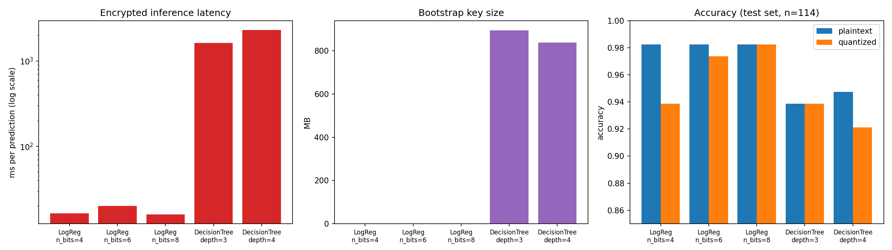

# Privacy-Preserving Medical Risk Screening with Fully Homomorphic Encryption

Encrypted machine-learning inference using [Concrete ML](https://github.com/zama-ai/concrete-ml) (TFHE). A client encrypts a patient record, a server runs a classifier on the ciphertext without ever seeing the data, and only the client can decrypt the prediction.

This project is a proof of concept and benchmark study built for a cryptography course. It is not a clinical tool.

## Motivation

A clinic may want a prediction from a cloud-hosted model (for example one that is proprietary or too large to run locally) without sending readable patient records to the provider. Fully homomorphic encryption (FHE) allows the provider to compute on encrypted inputs and return an encrypted result.

## What this repo does

1. Trains classifiers on the Breast Cancer Wisconsin dataset (scikit-learn built-in, 30 features, 569 samples, 80/20 stratified split).
2. Converts them to FHE-compatible form with Concrete ML (8-bit or lower integer quantization).
3. Runs inference on encrypted inputs and checks the output against the same model run in the clear.
4. Benchmarks accuracy, latency, key sizes, and bootstrapping cost across model types and quantization levels.
5. Demonstrates the client/server split: keys generated on the client, only evaluation keys given to the server.

## Results

Test set: 114 samples, single train/test split (random_state=42).

| Model | Config | Plaintext acc. | Quantized acc. | Encrypted time / prediction | Bootstraps | Bootstrap keys |
|---|---|---|---|---|---|---|
| Logistic regression | n_bits=4 | 98.25% | 93.86% | 16.4 ms | 0 | 0 MB |
| Logistic regression | n_bits=6 | 98.25% | 97.37% | 20.1 ms | 0 | 0 MB |
| Logistic regression | n_bits=8 | 98.25% | 98.25% | 15.9 ms | 0 | 0 MB |
| Decision tree | depth=3 | 93.86% | 93.86% | 1634 ms | 55 | 894 MB |
| Decision tree | depth=4 | 94.74% | 92.11% | 2312 ms | 82 | 839 MB |



Raw numbers: [`results/results.csv`](results/results.csv).

### Findings

- **Correctness.** In every configuration, encrypted predictions matched the quantized model run in the clear (agreement 1.0). Logistic regression was checked on all 114 test samples; decision trees on the first 20.
- **Quantization matters.** Logistic regression lost about 4.4 points of accuracy at 4 bits (5 more errors out of 114), about 0.9 points at 6 bits (1 more error), and nothing at 8 bits.
- **Bootstrapping is where the cost is.** Logistic regression needs only additions and constant multiplications, so it runs with no bootstrapping and no bootstrap keys, at roughly 16-20 ms per prediction. Decision trees need comparisons, which require programmable bootstrapping: 55-82 bootstraps per prediction, roughly 0.8-0.9 GB of bootstrap keys, and 1.6-2.3 s per prediction, about 100x slower than logistic regression here.
- **Key size did not track bootstrap count.** The depth-3 tree had more key material than the depth-4 tree despite fewer bootstraps. This likely reflects the cryptographic parameters the compiler chose for each circuit, and I did not investigate it further.
- **Overhead versus plaintext.** Plaintext inference took microseconds per sample, so encrypted inference is on the order of a thousand times slower or more. The plaintext timings in the CSV vary between runs (0.002 to 0.02 ms per sample), so I do not give a precise ratio.

### Client/server round trip (logistic regression, 30 features, n_bits=8)

From `src/client_server_demo.py`, one sample:

| Item | Value |
|---|---|
| Plain input | 240 bytes |
| Encrypted input | about 1 KB |
| Encrypted output | about 11 KB |
| Client encrypt | about 8-9 ms |
| Server compute | about 6-12 ms (varied between runs) |
| Client decrypt | about 2 ms |
| Evaluation keys | about 0 MB (no bootstrapping needed) |

Over all 114 test samples this model scored 98.25% both in plaintext and encrypted, with 100% agreement.

## Threat model and limitations

- **Honest-but-curious server.** The server follows the protocol but would read the data if it could. FHE protects input confidentiality against such a server. It does not prove the server computed the right answer; verifiable computation or zero-knowledge proofs would be needed for that.
- **The model is not hidden from the server.** The server holds the model in the clear. This demo protects the client's data, not the model owner's weights.
- **Simulated deployment.** Client and server run in one process in `client_server_demo.py`. There is no network service.
- **Small data, single split.** 114 test samples means one extra error moves accuracy by about 0.9 points. Differences of a point or two are within noise. No cross-validation was done.
- **Subset evaluation for trees.** Tree encrypted accuracy (95% and 90%) is measured on only 20 samples and is not comparable to the 114-sample figures.
- **Single runs.** Timings come from one run per configuration and are indicative, not statistically robust.
- **Toy dataset.** The Breast Cancer Wisconsin dataset was used because it is built into scikit-learn. The pipeline is not validated on real clinical deployments.
- **Tabular models only.** Neural networks were not evaluated; each nonlinear layer would add bootstrapping cost.

## Real-world context

FHE is used in production for narrow tasks such as private lookups (for example password breach checks in Microsoft Edge and caller lookup on iOS). General-purpose encrypted computation remains orders of magnitude slower than plaintext. Encrypted ML inference on small models has been demonstrated and piloted rather than widely deployed.

## Run it

Concrete ML supports Linux and macOS with Python 3.8-3.12 (use WSL or Docker on Windows). The results above were produced with Python 3.10 on Google Colab.

```bash
python -m venv .venv
source .venv/bin/activate
pip install -r requirements.txt

python src/benchmark.py
python src/client_server_demo.py
```

`benchmark.py` writes `results/results.csv` and `results/results.png`. It takes several minutes because the tree models run real encrypted inference.

## Possible next steps

- Wrap the client and server in a real HTTP service (FastAPI) with the keys split across processes.
- Replace the toy dataset with a real public health-screening dataset.
- Add cross-validation, repeated timing runs, and confidence intervals.
- Compare against other FHE schemes (CKKS, BFV) and larger models.
- Add verifiability for the server's computation.

## Acknowledgements

Built with [Concrete ML](https://docs.zama.ai/concrete-ml) by Zama and scikit-learn.
